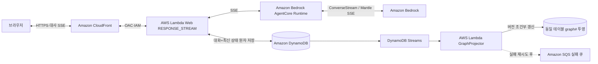

# SCENE · AWS 배포 패키지

[한국어](README.md) · [English](readme_en.md)

[배포 소스 ZIP 다운로드](https://github.com/jinuland/scene-agentcore-demo/raw/refs/heads/main/downloads/scene-aws-deploy.zip)

이 프로젝트에는 공개 캐릭터 챗 데모의 웹 화면, Lambda API, AgentCore Runtime, 작품 이미지, CDK 코드와 의존성 잠금 파일이 들어 있습니다. 기본 작품 다섯 개의 상세 화면에서 예시 대화 3턴을 볼 수 있습니다. 내 대화에는 브라우저에서 실제로 시작한 회차만 표시됩니다.

[한국어 데모](https://d3ib5121x21g7w.cloudfront.net/?lang=ko) · [English demo](https://d3ib5121x21g7w.cloudfront.net/?lang=en) · [日本語デモ](https://d3ib5121x21g7w.cloudfront.net/?lang=ja)

언어 메뉴를 바꾸면 화면, 기본 작품과 예시 대화, 새 모델 응답에 선택한 언어가 적용됩니다. 이미 저장된 메시지와 직접 작성한 작품은 입력된 언어로 표시됩니다.

## 준비

- Node.js 22.13 이상과 npm
- 사용할 AWS 계정에 로그인한 AWS CLI 프로필
- 기본 배포 리전은 서울(ap-northeast-2)입니다. 서울에서 Bedrock Runtime 글로벌 추론 프로파일을 호출하고, Bedrock Mantle은 미국 버지니아 북부(us-east-1)에서 호출합니다.
- 대상 계정에서 사용하려는 Bedrock 모델에 대한 접근을 활성화하세요. Anthropic을 처음 사용하는 계정은 사용 사례 등록이 필요할 수 있습니다. [Amazon Bedrock 모델 접근](https://docs.aws.amazon.com/bedrock/latest/userguide/model-access.html)

## 배포

저장소를 클론하거나 배포 ZIP을 푼 디렉터리에서 실행합니다. 아래의 customer-demo를 자신의 AWS CLI 프로필로 바꾸세요.

~~~sh
npm ci
aws sts get-caller-identity --profile customer-demo

scene_account="$(aws sts get-caller-identity --profile customer-demo --query Account --output text)"
npx cdk bootstrap "aws://$scene_account/ap-northeast-2" --profile customer-demo

npm run deploy -- --profile customer-demo
~~~

대상 리전에 CDK 부트스트랩이 되어 있으면 bootstrap 단계는 건너뛸 수 있습니다. [AWS CDK 부트스트랩](https://docs.aws.amazon.com/cdk/v2/guide/bootstrapping-env.html)

배포가 끝나면 CDK 출력과 **outputs/scene-demo-stack.json**의 **DemoUrl**을 공유하세요. CloudFront 주소 전파에 몇 분이 걸릴 수 있습니다. 처음 접속한 브라우저에서 작품을 골라 바로 시작할 수 있습니다. 브라우저마다 서명된 세션 쿠키로 작품과 회차를 구분합니다. 공개 데모의 모델 호출 한도는 서울 날짜 기준 전체 하루 500턴이고, 한 회차는 24턴입니다. 저장된 대화와 작품은 DynamoDB의 7일 TTL로 만료됩니다.

접속 코드가 필요한 배포는 다음 명령을 사용합니다.

~~~sh
npm run deploy -- --profile customer-demo -c sceneAccess=code
~~~

코드 모드에서 CloudFormation 출력 **AccessSecretArn**은 AWS Secrets Manager의 입장 코드 항목을 가리킵니다. 공개 모드에서도 이 값은 세션 쿠키 서명에 사용됩니다.

~~~sh
npm run synth -- --profile customer-demo
AWS_PROFILE=customer-demo npm run demo:character
~~~

synth는 소스 번들을 만들고 CloudFormation 템플릿을 생성합니다. 로컬 데모는 배포 출력의 Runtime ARN과 AWS CLI 자격 증명을 사용합니다.

## 아키텍처

브라우저 → CloudFront → Lambda Function URL → AgentCore Node.js Runtime → Amazon Bedrock. CloudFront가 Origin Access Control로 Lambda의 IAM 원본을 호출합니다. Lambda가 DynamoDB에서 작품·대화·상태를 조회하고 저장합니다. AgentCore가 작품 설정과 대화 문맥을 모델에 보내고 문장과 상태 판정 결과를 받습니다. [CloudFront에서 Lambda 원본 보호](https://docs.aws.amazon.com/AmazonCloudFront/latest/DeveloperGuide/private-content-restricting-access-to-lambda.html)

카탈로그의 작품과 삽화 출처, 모델 호출 형태는 [데모 설명](examples/agentcore-character-demo/README.md)에 있습니다.

## 모든 작품의 세계 엔진과 상태창 · 2026-11-22

스타워즈·아카데미·재회 로맨스·BL·임사랑 다섯 작품에 각각 장면, 조건부 공개 사실, 행동, 스탯, 사건, 분기 엔딩을 적용했습니다. 새 사용자 작품도 입력한 세계관을 유지하는 작은 기본 그래프를 받습니다. 세계 엔진은 자유 대화를 허용하면서 장면 이동과 엔딩 확정을 작가가 등록한 조건으로 제한합니다.

데스크톱의 오른쪽 패널에서 **현재 상태·장소·이야기 시간·스탯·진행 중인 사건·세계관·최근 변화**를 확인합니다. 모바일은 채팅 상단의 상태창 버튼을 누릅니다. 추천은 별도 모델 호출 없이 확정 상태로 계산하며, 끝낸 행동을 빼고 다음 단계의 준비·이동·선택을 우선 제시합니다. 현재 허용된 행동 추천을 그대로 선택하면 해석 모델도 건너뛰고 등록된 행동을 직접 실행합니다. 자유 입력은 Haiku가 해석합니다. 회차를 다시 열어도 같은 상태가 복원됩니다.

기존 그래프 회차는 고정된 규칙을 유지합니다. 그래프가 없던 회차는 기존 대화를 보존하고 다음 대화부터 상태를 기록합니다. 과거 대사를 소급 추측해 완료하지 않은 사건을 만들어내지 않습니다. [작품별 진행·엔딩·기존 대화 처리](docs/world-engine-guide.md)에 구현과 한계를 정리했습니다.

## 스트리밍과 비동기 그래프 · 2026-11-22

기본 대화 모델은 **Claude Sonnet 5.5**이며 Sonnet 5를 포함해 14개 모델을 선택할 수 있습니다. 대사는 JSON 객체 전체가 완성되기를 기다리지 않고 일반 텍스트 델타로 전달합니다. Bedrock → AgentCore SSE → Lambda 응답 스트리밍 → 브라우저가 모두 스트리밍합니다. JSON은 개별 SSE 이벤트와 작은 상태 판정에 사용하며 대사 스트리밍을 막지 않습니다.

기존 속도 벤치마크는 당시의 작품 정의와 입력 조건에서 측정한 기록입니다. 이번 모든 작품의 세계 엔진 적용 및 추천 행동 직접 처리 이후의 속도를 그 수치와 동일하다고 보장하지 않습니다.

위 AWS 아이콘 그림은 기본 호출 경로이며, 이 흐름도가 새 비동기 투영 경로까지 나타냅니다. 그래프 작품의 입력 해석과 숫자·게이트 계산은 대사 전에 수행합니다. 계산한 **현재 장면·허용된 전이·확정 행동**을 대사 모델에 전달합니다. 그래프 전체를 DB에 물질화하는 작업만 뒤로 분리했습니다. 이 계산까지 뒤로 미루면 대사가 보여 준 이동과 상태창이 어긋날 수 있습니다.

대화 원문·최신 상태·근거 기억은 한 회차 스냅샷으로 저장한 후 `state.committed`를 보냅니다. INFO는 이 확정 버전으로 갱신하고 다음 요청도 같은 스냅샷에서 시작합니다. DynamoDB Streams 소비자가 최신 스냅샷을 읽어 `graph#회차`를 비동기 갱신합니다. 중복·순서 역전을 버전 조건으로 처리하며 실패는 재시도 후 SQS에 보관합니다. 다음 대화는 지연될 수 있는 그래프 투영을 읽지 않습니다. 로컬 SQLite는 동일 트랜잭션에 투영 작업을 남기고 별도 작업으로 처리하며 재시작 때 미처리 작업을 재개합니다.

같은 `requestId` 재시도는 저장된 답변을 반환합니다. 부분 스트림·모델 실패는 회차를 진행시키지 않으며, 회차 잠금과 저장 버전 검사로 중복 저장을 막습니다. 브라우저의 생성 중 대사는 임시 표시이고 저장 확인 전에는 확정된 INFO가 아닙니다. 일반 작품은 기억 추출·스탯 판정과 대사를 병렬 실행합니다. 별도 LLM 사후 검수·재생성은 추가하지 않았습니다.

**시간 표시:** `Bedrock 첫 텍스트`는 Runtime 내부 모델 요청 시작부터 첫 텍스트 델타까지, `서비스 첫 대사`는 웹 서비스가 Runtime 호출을 시작한 후 첫 델타를 받은 시간입니다. 입력 해석·Runtime 대기·모델 생성은 일부 중첩되므로 더하면 안 됩니다. 브라우저 렌더링 시간과 전체 저장 완료는 별도입니다. 스트림 연결은 Runtime HTTP 응답 헤더까지, 스트림 수신은 헤더 이후 완료까지입니다. 응답 아래 단일 초 표시는 생성/Runtime 반환까지이며 저장 ACK 시각과 구별합니다. 이 값은 AWS 엔진 내부 실행 시작·종료 절대시각이 아닙니다.

**모델 옵션:** Sonnet 5는 `thinking: disabled`, Sonnet 5.5는 `thinking: between_tools`와 기본 effort `high`를 사용합니다. `adaptive`는 필요에 따라 추론량을 고르는 방식이고, `between_tools`는 high 이하에서 응답 전 추론을 건너뛰고 도구 사이의 추론을 허용하는 방식입니다. 대사 경로에는 실행 도구가 없으며 이 옵션 때문에 도구 호출이 생기지는 않습니다. effort는 전체 응답의 토큰 사용·상세함을 조절하므로 thinking type과 다른 축입니다. [AWS Sonnet 5.5](https://docs.aws.amazon.com/bedrock/latest/userguide/model-card-anthropic-claude-sonnet-5-5.html), [Adaptive thinking](https://docs.aws.amazon.com/bedrock/latest/userguide/claude-messages-adaptive-thinking.html), [Effort](https://platform.claude.com/docs/en/build-with-claude/effort)

GPT-6 Luna와 GPT-6.1 Terra는 실측에서 지원된 `reasoning.effort: none`을 사용합니다. Sol·Astra의 동일 none 요청은 거절되어 low를 유지합니다. Haiku 대사는 adaptive/low, 상태 해석·기억·스탯 보조 호출은 disabled/low입니다. 모델·계정·리전별 지원은 배포 시 확인해야 합니다.

속도와 품질의 실측·길이·옵션·제약은 [고객용 비교 가이드](docs/streaming-benchmark-20261122.md)를 참고하세요. 원본 사용자 대화, 쿠키, 실행 DB와 비공개 테스트 회차는 소스 ZIP에 포함하지 않습니다.

## 작품 그래프와 회차 상태

새 작품 **다시 사람을 좋아하게 되는 날이 다가온다면**에는 표지·장면 이미지·4컷 프롤로그 웹툰과 예시 대화 3턴이 포함됩니다. 원작 냥치기의 공개 작품 설정과 도입을 재사용 허락에 따라 옮겼으며, 삽화는 허락된 원작 이미지를 참고해 새로 생성했습니다. 원작의 내부 규칙은 제공받지 않았으므로 아래 여섯 장면과 세 엔딩의 조건은 이 데모에서 설계한 것입니다.

작품 정의는 `examples/agentcore-character-demo/sarang-story.ts`, 공통 실행기는 `lib/platform/narrative-graph.ts`에 있습니다. Scene·Fact·Action·Counter·Transition·Gate·Ending 노드와 ALLOWS·CHANGES·REQUIRES·READS·OPENS·REQUESTS_TRANSITION 관계로 Graphology 인메모리 그래프를 구성합니다. 공개 조건을 충족한 사실만 대사 모델에 전달합니다. 편의점 첫 만남 → 창가 대화 → 하굣길 → 다음 날 재회 → 공원 대화 → 도움의 계획으로 이어지며, 호감도 0~200%, 소통 카운터, 일회성 사건, 장면 최소 턴과 플레이어의 이동 의사를 함께 검사합니다. 엔딩은 ‘오늘의 인사’, ‘우리의 속도로’, ‘새로운 한 걸음’입니다.

한 턴의 순서는 **Haiku 입력 해석 → 상태 규칙 계산 → 대사 스트리밍 → 최신 상태 저장 → 비동기 그래프 투영**입니다. 해석 모델은 작가가 등록한 행동·전이 ID와 이번 발언의 원문 근거만 고릅니다. 카운터와 시간, 이동, 엔딩은 코드가 계산합니다. 대사 생성 후 별도 LLM 검수나 재생성 단계는 없습니다. API는 반환 상태를 같은 규칙으로 재계산하는 코드 검사와 회차 잠금을 통과한 경우에만 대화와 상태를 저장합니다. 실패하면 진행 상태도 저장하지 않습니다.

작가 정의의 행동에는 선택적으로 `opensTransition`을 지정할 수 있습니다. 예를 들어 `walk-together` 행동을 `walk-home` 전이에 연결하면, 입력 근거가 확인된 행동이 그 전이를 요청하고 코드가 기존 카운터·최소 턴 게이트를 검사합니다. 별도의 전이 ID가 모델 출력에서 누락돼도 행동과 상태 이동이 함께 처리됩니다. 복수의 서로 다른 목적지가 충돌하면 자동 선택하지 않습니다. 이는 작품 JSON 규칙이며 자유 입력 작품 생성 화면이 자동으로 설계하는 기능은 아닙니다. 사랑 작품의 새 회차는 정의 v2를 사용하고 기존 회차는 저장된 정의 버전을 유지합니다.

회차마다 작품 정의 버전과 해시, 현재 장면·시각·카운터·사건/전이 이력을 함께 저장합니다. 실행 중 그래프는 메모리에 있으며, 다음 요청 때 저장된 스냅샷에서 재구성하므로 Runtime 종료에 복원을 의존하지 않습니다. 클라우드는 DynamoDB, 로컬 웹 API는 SQLite WAL을 사용합니다. SQLite 파일은 AgentCore 내부 임시 디스크가 아니라 로컬 API의 데이터 디렉터리에 있습니다. 여러 사용자의 공동 회차 UI, 자유 입력에서 작품 그래프를 자동 생성하는 기능, 임베딩 기반 기억 검색은 이번 데모 범위에 포함되지 않습니다. 그래프와 모델에 전달하는 최근 대화·근거 기억은 별도의 데이터입니다.

상태창에서 날짜·일차·장면·호감도·다음 조건을 볼 수 있고, 응답 아래 **처리 시간 보기**에서 입력 해석·상태 규칙 계산·대사 생성 시간을 확인할 수 있습니다. 스트림 연결은 호출 후 응답 헤더까지, 스트림 수신은 헤더 후 Runtime 완료까지이며 해석·모델 단계와 중첩됩니다. 종료된 회차는 읽을 수 있고, 새 회차에서 다시 선택할 수 있습니다.

`npm test`는 배포 패키지에서 그래프 게이트, 범위, 세 엔딩 도달, 상태 재계산, JSON 디코딩 후 버전 일치, SQLite 재연결 복원과 소유자별 삭제를 검사합니다.

## 검증 · 2026-11-20

- 회귀 검사 35개와 독립 ZIP 설치 후 그래프 검사 9개 및 빌드가 통과했습니다. DynamoDB 맵의 필드 순서가 바뀌어도 상태를 복원·검증하며, 변조된 수치나 사건 이력은 거부합니다.
- 실제 Bedrock 모델을 호출하는 로컬 Runtime HTTP 테스트에서 12턴으로 여섯 장면과 ‘새로운 한 걸음’ 엔딩에 도달했습니다. 나머지 두 엔딩의 도달 조건도 자동 검사했습니다.
- 공개 배포에서 GPT-6 Luna, Grok 4.3, Claude Haiku 5.5, Gemma 4 31B, Gemma 4 E2B의 응답과 회차 재조회를 확인했습니다. 영어·일본어 응답과 UI도 확인했습니다. 이번 새 작품 검사로 13종 전체의 대화 품질을 보장하지는 않습니다.
- 브라우저의 Grok 4.3 두 턴은 5.0초·6.4초였고, 호감도 10→14→22, 편의점 창가 장면 전이, 새로고침 후 복원이 확인됐습니다. 테스트용 회차는 삭제했습니다. 실제 속도는 모델과 초기 실행 상태에 따라 달라집니다.

## 답변 길이·회차 이어가기

장면형·길게(기본, 한국어550~750자 목표)와 대화형·짧게를 선택할 수 있습니다. 분량은 모델에 따라 달라지며 보장하지 않습니다. [Grok4.3·Sonnet5.5 실제 길이·속도·품질 비교](docs/length-quality-benchmark-20261122.md)에 동일 프롬프트 실패 사례와 분량 보정 실험을 함께 공개했습니다. 이야기 품질을 우선하는 데모 기본값은 Sonnet5.5를 유지합니다.

레코드 바 재회 작품 v2에서는 커피 약속과 오늘의 인사를 중간 진행으로 표시합니다. 같은 대화에서 카페 재회·B-12 관리 기록·관계 선택까지 이어집니다. 기존 v1의 조기 종료 회차는 대화와 선택을 보존해 다시 이어갈 수 있습니다. 최종 엔딩은 관계를 실제로 정하는 선택으로 구분합니다.
