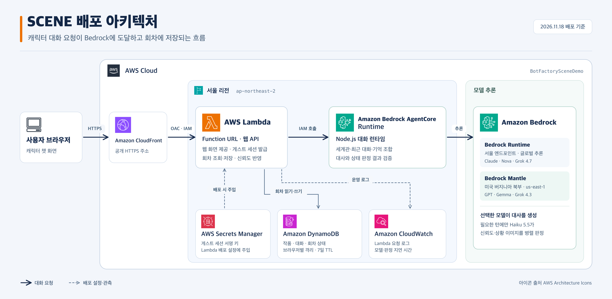

# SCENE · AWS 배포 패키지

[한국어](README.md) · [English](readme_en.md)

[배포 소스 ZIP 다운로드](https://github.com/jinuland/scene-agentcore-demo/raw/refs/heads/main/downloads/scene-aws-deploy.zip)

이 프로젝트에는 공개 캐릭터 챗 데모의 웹 화면, Lambda API, AgentCore Runtime, 작품 이미지, CDK 코드와 의존성 잠금 파일이 들어 있습니다. 기본 작품 다섯 개의 상세 화면에서 예시 대화 3턴을 볼 수 있습니다. 내 대화에는 브라우저에서 실제로 시작한 회차만 표시됩니다.

[한국어 데모](https://d3ib5121x21g7w.cloudfront.net/?lang=ko) · [English demo](https://d3ib5121x21g7w.cloudfront.net/?lang=en) · [日本語デモ](https://d3ib5121x21g7w.cloudfront.net/?lang=ja)

언어 메뉴를 바꾸면 화면, 기본 작품과 예시 대화, 새 모델 응답에 선택한 언어가 적용됩니다. 이미 저장된 메시지와 직접 작성한 작품은 입력된 언어로 표시됩니다.

## 준비

- Node.js 22.13 이상과 npm
- 사용할 AWS 계정에 로그인한 AWS CLI 프로필
- 기본 배포 리전은 서울(ap-northeast-2)입니다. 서울에서 Bedrock Runtime 글로벌 추론 프로파일을 호출하고, Bedrock Mantle은 미국 버지니아 북부(us-east-1)에서 호출합니다.
- 대상 계정에서 사용하려는 Bedrock 모델에 대한 접근을 활성화하세요. Anthropic을 처음 사용하는 계정은 사용 사례 등록이 필요할 수 있습니다. [Amazon Bedrock 모델 접근](https://docs.aws.amazon.com/bedrock/latest/userguide/model-access.html)

## 배포

저장소를 클론하거나 배포 ZIP을 푼 디렉터리에서 실행합니다. 아래의 customer-demo를 자신의 AWS CLI 프로필로 바꾸세요.

~~~sh
npm ci
aws sts get-caller-identity --profile customer-demo

scene_account="$(aws sts get-caller-identity --profile customer-demo --query Account --output text)"
npx cdk bootstrap "aws://$scene_account/ap-northeast-2" --profile customer-demo

npm run deploy -- --profile customer-demo
~~~

대상 리전에 CDK 부트스트랩이 되어 있으면 bootstrap 단계는 건너뛸 수 있습니다. [AWS CDK 부트스트랩](https://docs.aws.amazon.com/cdk/v2/guide/bootstrapping-env.html)

배포가 끝나면 CDK 출력과 **outputs/scene-demo-stack.json**의 **DemoUrl**을 공유하세요. CloudFront 주소 전파에 몇 분이 걸릴 수 있습니다. 처음 접속한 브라우저에서 작품을 골라 바로 시작할 수 있습니다. 브라우저마다 서명된 세션 쿠키로 작품과 회차를 구분합니다. 공개 데모의 모델 호출 한도는 서울 날짜 기준 전체 하루 500턴이고, 한 회차는 24턴입니다. 저장된 대화와 작품은 DynamoDB의 7일 TTL로 만료됩니다.

접속 코드가 필요한 배포는 다음 명령을 사용합니다.

~~~sh
npm run deploy -- --profile customer-demo -c sceneAccess=code
~~~

코드 모드에서 CloudFormation 출력 **AccessSecretArn**은 AWS Secrets Manager의 입장 코드 항목을 가리킵니다. 공개 모드에서도 이 값은 세션 쿠키 서명에 사용됩니다.

~~~sh
npm run synth -- --profile customer-demo
AWS_PROFILE=customer-demo npm run demo:character
~~~

synth는 소스 번들을 만들고 CloudFormation 템플릿을 생성합니다. 로컬 데모는 배포 출력의 Runtime ARN과 AWS CLI 자격 증명을 사용합니다.

## 아키텍처

브라우저 → CloudFront → Lambda Function URL → AgentCore Node.js Runtime → Amazon Bedrock. CloudFront가 Origin Access Control로 Lambda의 IAM 원본을 호출합니다. Lambda가 DynamoDB에서 작품·대화·상태를 조회하고 저장합니다. AgentCore가 작품 설정과 대화 문맥을 모델에 보내고 문장과 상태 판정 결과를 받습니다. [CloudFront에서 Lambda 원본 보호](https://docs.aws.amazon.com/AmazonCloudFront/latest/DeveloperGuide/private-content-restricting-access-to-lambda.html)

카탈로그의 작품과 삽화 출처, 모델 호출 형태는 [데모 설명](examples/agentcore-character-demo/README.md)에 있습니다.

## 작품 그래프와 회차 상태

새 작품 **다시 사람을 좋아하게 되는 날이 다가온다면**에는 표지·장면 이미지·4컷 프롤로그 웹툰과 예시 대화 3턴이 포함됩니다. 원작 냥치기의 공개 작품 설정과 도입을 재사용 허락에 따라 옮겼으며, 삽화는 허락된 원작 이미지를 참고해 새로 생성했습니다. 원작의 내부 규칙은 제공받지 않았으므로 아래 여섯 장면과 세 엔딩의 조건은 이 데모에서 설계한 것입니다.

작품 정의는 `examples/agentcore-character-demo/sarang-story.ts`, 공통 실행기는 `lib/platform/narrative-graph.ts`에 있습니다. Scene·Fact·Action·Counter·Transition·Gate·Ending 노드와 ALLOWS·CHANGES·REQUIRES·READS·OPENS 관계로 Graphology 인메모리 그래프를 구성합니다. 공개 조건을 충족한 사실만 대사 모델에 전달합니다. 편의점 첫 만남 → 창가 대화 → 하굣길 → 다음 날 재회 → 공원 대화 → 도움의 계획으로 이어지며, 호감도 0~200%, 소통 카운터, 일회성 사건, 장면 최소 턴과 플레이어의 이동 의사를 함께 검사합니다. 엔딩은 ‘오늘의 인사’, ‘우리의 속도로’, ‘새로운 한 걸음’입니다.

한 턴의 순서는 **Haiku 입력 해석 → 그래프 규칙 계산 → 선택한 모델의 대사 생성 → 저장**입니다. 해석 모델은 작가가 등록한 행동·전이 ID와 이번 발언의 원문 근거만 고릅니다. 카운터와 시간, 이동, 엔딩은 코드가 계산합니다. 대사 생성 후 별도 LLM 검수나 재생성 단계는 없습니다. API는 반환 상태를 같은 규칙으로 재계산하는 코드 검사와 회차 잠금을 통과한 경우에만 대화와 상태를 저장합니다. 실패하면 진행 상태도 저장하지 않습니다.

회차마다 작품 정의 버전과 해시, 현재 장면·시각·카운터·사건/전이 이력을 함께 저장합니다. 실행 중 그래프는 메모리에 있으며, 다음 요청 때 저장된 스냅샷에서 재구성하므로 Runtime 종료에 복원을 의존하지 않습니다. 클라우드는 DynamoDB, 로컬 웹 API는 SQLite WAL을 사용합니다. SQLite 파일은 AgentCore 내부 임시 디스크가 아니라 로컬 API의 데이터 디렉터리에 있습니다. 여러 사용자의 공동 회차 UI, 자유 입력에서 작품 그래프를 자동 생성하는 기능, 임베딩 기반 기억 검색은 이번 데모 범위에 포함되지 않습니다. 그래프와 모델에 전달하는 최근 대화·근거 기억은 별도의 데이터입니다.

상태창에서 날짜·일차·장면·호감도·다음 조건을 볼 수 있고, 응답 아래 **처리 시간 보기**에서 입력 해석·그래프 계산·대사 생성 시간을 확인할 수 있습니다. AgentCore 응답 대기 시간은 모델 실행을 포함한 전체 호출 시간이며 다른 단계와 중첩됩니다. 종료된 회차는 읽을 수 있고, 새 회차에서 다시 선택할 수 있습니다.

`npm test`는 배포 패키지에서 그래프 게이트, 범위, 세 엔딩 도달, 상태 재계산, JSON 디코딩 후 버전 일치, SQLite 재연결 복원과 소유자별 삭제를 검사합니다.

## 검증 · 2026-11-20

- 회귀 검사 35개와 독립 ZIP 설치 후 그래프 검사 9개 및 빌드가 통과했습니다. DynamoDB 맵의 필드 순서가 바뀌어도 상태를 복원·검증하며, 변조된 수치나 사건 이력은 거부합니다.
- 실제 Bedrock 모델을 호출하는 로컬 Runtime HTTP 테스트에서 12턴으로 여섯 장면과 ‘새로운 한 걸음’ 엔딩에 도달했습니다. 나머지 두 엔딩의 도달 조건도 자동 검사했습니다.
- 공개 배포에서 GPT-6 Luna, Grok 4.3, Claude Haiku 5.5, Gemma 4 31B, Gemma 4 E2B의 응답과 회차 재조회를 확인했습니다. 영어·일본어 응답과 UI도 확인했습니다. 이번 새 작품 검사로 13종 전체의 대화 품질을 보장하지는 않습니다.
- 브라우저의 Grok 4.3 두 턴은 5.0초·6.4초였고, 호감도 10→14→22, 편의점 창가 장면 전이, 새로고침 후 복원이 확인됐습니다. 테스트용 회차는 삭제했습니다. 실제 속도는 모델과 초기 실행 상태에 따라 달라집니다.
