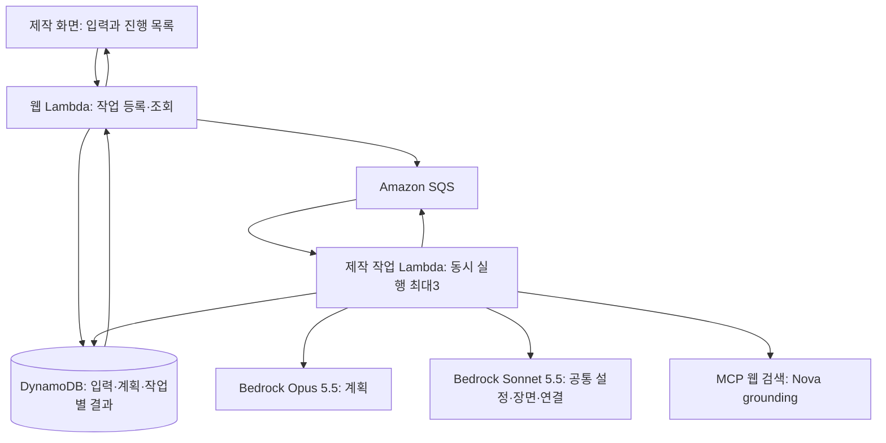

# 계획하고 나누어 만드는 이야기 제작

2026-11-22 · 소스/ZIP 1.8.1 · scene-stream/13

작품 만들기의 **어린왕자 예제**를 누르면 여섯 장면, 세 스탯, 중도 실패 두 개와 최종 결말 세 개가 담긴 설명을 불러옵니다. **Opus로 계획하고 이야기 구성하기**를 누르면 아래 작업을 시작합니다. 왼쪽 입력은 계속 편집할 수 있습니다.

1. **Opus 5.5 계획:** 작가가 지정한 장면 수와 순서, 초기값과 증감량, 최소 턴과 엔딩 조건을 정리합니다. 공통 ID와 장면의 입장·완료 상황, 제작 선행 관계를 정합니다. 해석이 필요한 부분은 계획의 ‘보완한 점’에 표시합니다.
2. **Sonnet 5.5 공통 설정:** 세계관과 캐릭터 말투·외형을 작성합니다. 수치는 계획에서 고정합니다.
3. **Sonnet 5.5 장면 작업자:** 공통 설정을 공유하고 최대 세 작업을 함께 실행합니다. 선행 장면의 실제 결과가 필요한 작업은 그 장면의 완료를 기다립니다. 제작 의존 관계와 플레이의 장면 이동 순서는 별개입니다.
4. **Sonnet 5.5 연결 서술:** 장면 결과를 받아 프롤로그·첫 대사·엔딩 서술을 작성합니다.
5. **코드 조립과 검사:** 장면·인물·스탯 참조, 수치 범위, 장면 연결을 검사합니다. 장면 이동에는 최소 턴과 장면 완료 사건이 모두 필요하며, 최종 엔딩은 마지막 선택 전에 확정되지 않습니다. 추가 LLM 심사로 재생성을 반복하지 않습니다.
6. **작가 검토:** 완성된 구성을 열어 장면·스탯·선택 결과·엔딩을 읽고 적용합니다. 초안 저장·테스트 채팅·작품 등록은 별도입니다. 제작 중 입력을 수정했다면 오래된 결과를 그대로 적용하지 않습니다. ‘변경한 설명으로 다시 계획하기’를 사용합니다.

시작 버튼을 누르면 중복 시작 버튼을 비활성화하고 진행 패널로 스크롤·포커스를 이동합니다. 진행 패널은 강조 테두리, 현재 작업 설명과 실제 완료 개수 막대를 표시합니다. 버튼 아래의 ‘진행 상황 보기’로 다시 이동할 수 있습니다. 입력 편집은 계속 가능합니다. 새로고침으로 복원한 진행 중 작업에도 버튼 비활성화가 적용됩니다.

진행 목록에서 각 작업의 담당 모델, 대기/진행/완료/실패, 선행 작업 대기 이유, 시작·종료 시각, 완료된 초안을 확인합니다. 실패한 작업은 해당 작업만 재시도할 수 있으며 다른 완료 결과는 유지됩니다. 유료 모델 작업의 명시적 시도는 최대 세 번입니다. 모델을 호출하지 않는 마지막 조립 검사는 수정 배포 후에도 다시 검사할 수 있습니다. 모델 호출 실패를 숨기고 계속 유료 재호출하지 않습니다. 이전 작업을 바탕으로 다시 계획하면 입력 지문이 같은 공통 설정과 장면 결과를 재사용합니다. 계획의 변경 범위나 ID가 달라지면 재사용 범위도 줄어듭니다.

## 웹 검색

오른쪽 **웹 검색 사용** 설정은 작업을 시작할 때 계획자와 모든 하위 작업자에 공통으로 고정됩니다. 각 모델은 실제 MCP 클라이언트/서버로 제공된 `web_search`를 필요할 때 호출할 수 있습니다. 체크했다고 모두 검색하지는 않습니다. 완료한 조사와 출처를 후속 작업에 전달합니다. 작업마다 최대 한 번 검색하며, 도구 호출을 포함한 모델 라운드는 최대 세 번입니다.

웹 검색은 미국 버지니아 리전의 Amazon Nova 2 Lite US inference profile 및 `amazon.nova_grounding`을 사용합니다. 검색 링크는 해당 작업 아래에 표시합니다. 검색 결과는 참고 자료이며 설정 수정 권한이나 실행 지시로 취급하지 않습니다. 원작 사실, 모델의 해석, 창작 설정을 검토해야 합니다.

## AWS와 복원

DynamoDB에는 서명된 브라우저 세션의 소유자별로 작업 원본과 각 작업 결과를 나누어 저장합니다. 작업 생성은 요청 UUID로 중복을 막고, 실행권과 결과 갱신은 조건부 쓰기로 보호합니다. SQS 메시지가 중복 전달되어도 완료 작업의 모델을 다시 호출하지 않습니다. 실행 중단 후에는 만료된 실행권을 복구할 수 있습니다. 화면의 진행 조회도 누락된 다음 작업 연결을 재개합니다.

작업용 Lambda는 최대4분, SQS 가시성은5분이며, 작업 실행권은270초입니다. 모델 작업 내부 대기 상한은210초입니다. 인프라 전달 실패는 최대3회 후 별도 실패 대기열에 남습니다. 모델 실패는 작업 오류로 저장하고 사용자의 재시도를 기다립니다. 작업 상태 조회만으로 실패한 모델 작업을 유료 재시도하지 않습니다.

로컬 실행은 별도 SQLite WAL 데이터베이스(`CHARACTER_DEMO_DB` 경로 뒤 `.author.sqlite`)와 최대3개 로컬 작업자를 사용합니다. 새로고침은 작업을 중단하지 않습니다. 로컬 서버를 재시작한 뒤 실행 중단 작업은 실행권 만료 후 다시 조회하면 재개됩니다. 클라우드의 작업·초안 보존은 기존 데모의7일 TTL을 사용합니다.

## 수치와 비용

Opus는 adaptive thinking/medium으로 계획하며, Sonnet은 between_tools/low로 담당 결과를 작성합니다. 내부 추론 원문은 저장하거나 화면에 표시하지 않습니다. 작업 결과에는 완료 호출의 입력·출력 토큰 수를 기록합니다. 계획 1회, 공통 설정 1회, 장면별 호출, 연결 1회가 기본이며 검색·도구 오류 수정 라운드는 추가 호출입니다. 전체 호출 수가 한 번 생성보다 많으므로 항상 더 싸거나 더 빠르다고 보장하지 않습니다. 각 실제 모델 호출과 검색은 기존 일일 사용 한도를 공유합니다.

[Adaptive thinking 설명](https://docs.aws.amazon.com/bedrock/latest/userguide/claude-messages-adaptive-thinking.html) · [Nova 웹 grounding](https://docs.aws.amazon.com/nova/latest/nova2-userguide/web-grounding.html)

## API

- `GET /api/creator/examples/little-prince`: 어린왕자 제작 설명 예제.
- `POST /api/creator/jobs`: `{requestId, document, brief, webSearch, reuseJobId?}`. 작업 등록 후 즉시 작업 번호와 상태를 반환합니다.
- `GET /api/creator/jobs/:id`: 내 작업 상태와 완료 결과 조회.
- `POST /api/creator/jobs/:id/retry`: `{taskId}`. 실패한 작업만 재시도합니다.

기존 초안·검사·테스트 채팅·등록 API를 그대로 사용합니다. 제작 완료가 곧 작품 공개를 뜻하지 않습니다. 다른 소유자의 작업 조회는404입니다. GPU 이미지는 비활성 상태이며, 사용자 지정 이미지 모델을 확인한 뒤 연결합니다. 이 버전은 GPU를 새로 만들거나 이미지 생성 작업을 실행하지 않습니다.

## 한계와 검증

구조 검사가 작가 의도의 완전한 해석이나 대화 품질을 증명하지는 않습니다. 자연어 완료 기준은 자유 입력의 행동 해석 모델이 판별합니다. 작성한 추천 버튼은 명시적인 작가 행동으로 실행합니다. 공통 행동을 장면 완료에 연결하면 기존 일회성·수치 조건을 그대로 검사하며 적용합니다. 사용자가 이미 받은 일회성 보상을 완료 버튼에서 다시 받지 않습니다.

어린왕자 첫 직접 실행에서는 전체 약102초, Opus 계획58초, 공통 설정16초, 장면 여섯 개의 병렬 생성15초, 연결 서술13초에 완료했습니다. 한 사례이며 네트워크·검색·모델 부하에 따라 달라집니다. 모든 장면의 최소3턴과 초기값50·60·30을 보존했습니다. 세 최종 엔딩과 두 중도 실패의 엔진 조건, 경계 수치24조합을 검사했습니다. 

2026-11-22 실제 AWS 검증에서는 제작 약123초(대기열 대기 포함), Opus 계획52.7초, 공통 설정18.1초, 장면 여섯 개 생성15.6초, 연결9.9초를 기록했습니다. 세 장면의 실행 시간이 겹쳐 실제 병렬 수행을 확인했습니다. 생성 작품으로 Sonnet5.5 대화를18턴 진행해 여섯 장면과 ‘가장 소중한 별’ 엔딩에 도달했습니다. 매 턴 재조회한 저장 상태가 응답 상태와 같았고, 장면의 최소 턴·완료 행동을 모두 충족하기 전에는 이동하거나 끝나지 않았습니다. 여우의 깨달음 보상은 기존 행동으로 한 번 받은 뒤 장면 완료에서도 중복 지급되지 않았습니다.

별도의 공개 브라우저 제작에서는 MCP 웹 검색을 실제 호출해 공식 어린왕자 사이트 등 출처를 표시했고,10개 작업 완료 후 새로고침으로 결과를 복원했습니다. 생성 결과의 초기값50·60·30과 여섯 장면을 검토·적용하고 테스트 회차를 만들었습니다. 브라우저에서3턴 대화 후 왕의 별로 이동했고, 유대감80·순수한 시선60·장미의 기억50과 세 추천이 새로고침 뒤에도 유지됐습니다. 데스크톱에서는 대화와 오른쪽 상태창을 함께, 작은 화면에서는 상태창을 별도로 여는 동작을 확인했습니다. 계획에 보완한 해석도 표시됩니다. 예를 들어 ‘물을 마신 후3턴’을 우물 장면 최소4턴으로 해석한 사례가 있으므로, 수치가 바뀐 해석은 작가가 적용 전 확인해야 합니다.

독립 소스 ZIP에서60개 검사가 통과했고 배포 번들 빌드가 성공했습니다. 검사는 소유자 격리, 작업 복원, 실패 작업만 재시도, 완료 결과 재사용, 순차 의존, 병렬 준비 작업, 최소 턴과 완료 사건의 결합, 일회성 보상 중복 방지를 포함합니다. 수치 경계 검사는 엔진에 상태를 주입한 검사이며 모든 분기의 전체 대화를 플레이한 결과를 뜻하지 않습니다.

### 미디어 연결 복구 · 1.8.1

제작 전 임시 주인공에 등록한 이미지가 새 캐릭터 ID와 맞지 않아 마지막 조립에서 `Unknown media character`로 실패하는 오류를 수정했습니다. 임시 주인공의 이미지와 기준 모습은 생성된 첫 장면의 주인공으로 연결합니다. 기존 작품은 동일 ID 또는 유일하게 일치하는 인물 이름·장면 제목·스탯 이름으로만 참조를 옮깁니다. 조건과 장면 범위를 지워서 이미지를 무조건 노출하지 않습니다. 확인할 수 없는 참조는 기존 파일을 보존하고 수정할 연결을 표시합니다. 적용 버튼에서도 수리한 참조를 유지하면서 최신 업로드 파일을 보존합니다.

이 오류로 실패한 기존 작업은 이미 완료된 계획·장면 결과를 유지한 채 마지막 ‘이 작업만 재시도’를 실행하면 됩니다. 마지막 조립은 LLM을 다시 호출하지 않습니다. 기존 유료 작업의 재시도 상한은 유지합니다.
