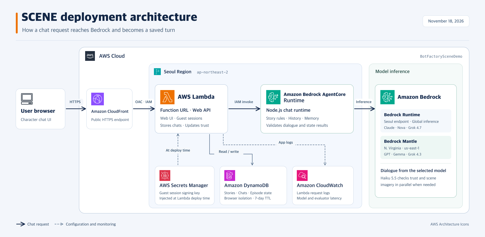

# SCENE · AWS deployment guide

[한국어](README.md) · [English](readme_en.md)

SCENE is a character chat demo built with Amazon Bedrock AgentCore. The repository includes the web app, Lambda API, AgentCore Runtime, story artwork, CDK infrastructure, and a dependency lockfile. Each of the four built-in stories includes a three-turn conversation preview. **My Chats** lists episodes started in the current browser.

[Try the live demo](https://d3ib5121x21g7w.cloudfront.net/)

## Prerequisites

- Node.js 22.13 or later and npm
- An authenticated AWS CLI profile for the target AWS account
- The default deployment region is Seoul (ap-northeast-2). The application calls Bedrock Runtime global inference profiles from Seoul and Bedrock Mantle from Northern Virginia (us-east-1).
- Enable access to the Bedrock models you plan to use in the target account. An account using Anthropic models for the first time may need to submit use case details. [Amazon Bedrock model access](https://docs.aws.amazon.com/bedrock/latest/userguide/model-access.html)

## Deploy

Clone the repository or extract the deployment ZIP, then run these commands from the project root. Replace customer-demo with your AWS CLI profile name.

~~~sh
npm ci
aws sts get-caller-identity --profile customer-demo

scene_account="$(aws sts get-caller-identity --profile customer-demo --query Account --output text)"
npx cdk bootstrap "aws://$scene_account/ap-northeast-2" --profile customer-demo

npm run deploy -- --profile customer-demo
~~~

Skip the bootstrap step if CDK has already been bootstrapped in the target account and region. [AWS CDK bootstrapping](https://docs.aws.amazon.com/cdk/v2/guide/bootstrapping-env.html)

After deployment, share **DemoUrl** from the CDK output or **outputs/scene-demo-stack.json**. CloudFront propagation can take a few minutes. Visitors can pick a story and start chatting as guests. A signed browser cookie keeps each guest's stories and episodes separate. The public demo allows 500 model turns per deployment each day, using the Seoul calendar date, and 24 turns per episode. DynamoDB uses a seven-day TTL for saved episodes and stories.

To require an access code, deploy with this command.

~~~sh
npm run deploy -- --profile customer-demo -c sceneAccess=code
~~~

In code mode, the CloudFormation output **AccessSecretArn** points to the access code in AWS Secrets Manager. The application uses the same secret to sign session cookies in either mode.

To synthesize the CloudFormation template or run the demo locally, use the commands below. The local demo uses the Runtime ARN in the deployment output and your AWS CLI credentials.

~~~sh
npm run synth -- --profile customer-demo
AWS_PROFILE=customer-demo npm run demo:character
~~~

## Architecture

CloudFront uses Origin Access Control to call the IAM-protected Lambda Function URL. Lambda serves the app and reads and writes stories, messages, and episode state in DynamoDB. The Node.js runtime on AgentCore sends story rules and conversation context to Amazon Bedrock, then validates the dialogue and state decisions returned by the models. [Restrict access to Lambda origins with CloudFront](https://docs.aws.amazon.com/AmazonCloudFront/latest/DeveloperGuide/private-content-restricting-access-to-lambda.html)

See the [demo notes in Korean](examples/agentcore-character-demo/README.md) for story and artwork credits and details about the model calls.
