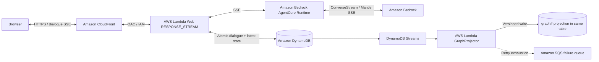

# SCENE · AWS deployment guide

[한국어](README.md) · [English](readme_en.md)

[Download deployment source ZIP](https://github.com/jinuland/scene-agentcore-demo/raw/refs/heads/main/downloads/scene-aws-deploy.zip)

SCENE is a character chat demo built with Amazon Bedrock AgentCore. The repository includes the web app, Lambda API, AgentCore Runtime, story artwork, CDK infrastructure, and a dependency lockfile. Each of the five built-in stories includes a three-turn conversation preview. **My Chats** lists episodes started in the current browser.

[English demo](https://d3ib5121x21g7w.cloudfront.net/?lang=en) · [日本語デモ](https://d3ib5121x21g7w.cloudfront.net/?lang=ja) · [한국어 데모](https://d3ib5121x21g7w.cloudfront.net/?lang=ko)

The language selector applies to the interface, the built-in stories and sample dialogue, and new model replies. Previously saved messages and user-authored story text are displayed in their original language.

## Prerequisites

- Node.js 22.13 or later and npm
- An authenticated AWS CLI profile for the target AWS account
- The default deployment region is Seoul (ap-northeast-2). The application calls Bedrock Runtime global inference profiles from Seoul and Bedrock Mantle from Northern Virginia (us-east-1).
- Enable access to the Bedrock models you plan to use in the target account. An account using Anthropic models for the first time may need to submit use case details. [Amazon Bedrock model access](https://docs.aws.amazon.com/bedrock/latest/userguide/model-access.html)

## Deploy

Clone the repository or extract the deployment ZIP, then run these commands from the project root. Replace customer-demo with your AWS CLI profile name.

~~~sh
npm ci
aws sts get-caller-identity --profile customer-demo

scene_account="$(aws sts get-caller-identity --profile customer-demo --query Account --output text)"
npx cdk bootstrap "aws://$scene_account/ap-northeast-2" --profile customer-demo

npm run deploy -- --profile customer-demo
~~~

Skip the bootstrap step if CDK has already been bootstrapped in the target account and region. [AWS CDK bootstrapping](https://docs.aws.amazon.com/cdk/v2/guide/bootstrapping-env.html)

After deployment, share **DemoUrl** from the CDK output or **outputs/scene-demo-stack.json**. CloudFront propagation can take a few minutes. Visitors can pick a story and start chatting as guests. A signed browser cookie keeps each guest's stories and episodes separate. The public demo allows 500 model turns per deployment each day, using the Seoul calendar date, and 24 turns per episode. DynamoDB uses a seven-day TTL for saved episodes and stories.

To require an access code, deploy with this command.

~~~sh
npm run deploy -- --profile customer-demo -c sceneAccess=code
~~~

In code mode, the CloudFormation output **AccessSecretArn** points to the access code in AWS Secrets Manager. The application uses the same secret to sign session cookies in either mode.

To synthesize the CloudFormation template or run the demo locally, use the commands below. The local demo uses the Runtime ARN in the deployment output and your AWS CLI credentials.

~~~sh
npm run synth -- --profile customer-demo
AWS_PROFILE=customer-demo npm run demo:character
~~~

## Architecture

CloudFront uses Origin Access Control to call the IAM-protected Lambda Function URL. Lambda serves the app and reads and writes stories, messages, and episode state in DynamoDB. The Node.js runtime on AgentCore sends story rules and conversation context to Amazon Bedrock, then validates the dialogue and state decisions returned by the models. [Restrict access to Lambda origins with CloudFront](https://docs.aws.amazon.com/AmazonCloudFront/latest/DeveloperGuide/private-content-restricting-access-to-lambda.html)

See the [demo notes in Korean](examples/agentcore-character-demo/README.md) for story and artwork credits and details about the model calls.

## World engine for every story · 2026-11-22

All five built-in works—Star Wars, the summoning academy, the record-bar reunion, BL radio, and Sarang—have authored scenes, gated facts, actions, stats, plot threads, and multiple endings. Custom works receive a small baseline graph that retains the creator's setting. Free dialogue stays available; only authored graph conditions can commit scene changes and endings.

The desktop sidebar shows **current state, location, story time, stats, active plot threads, world background, and recent changes**. On mobile, open the status button in the chat header. Suggestions are selected from eligible authored choices without another model call. Completed one-time actions disappear, and actions that advance the current plot take priority. Selecting an exact eligible action suggestion executes its authored graph action directly and skips the interpretation model; free text still uses Haiku.

Existing graph episodes keep their pinned rules. Older episodes without a graph retain their transcript and begin explicit world tracking with subsequent turns. Historical actions are not invented or backfilled. See the [world-engine guide](docs/world-engine-guide.md) (Korean) for story paths, ending branches, persistence, and limitations.

## Streaming and asynchronous graph projection · 2026-11-22

**Claude Sonnet 5.5** is the default; 14 models including Sonnet 5 are selectable. Plain dialogue deltas stream end to end through Bedrock, AgentCore SSE, Lambda RESPONSE_STREAM and the browser. JSON frames individual SSE events and compact metadata; it no longer buffers a complete dialogue object.

The AWS icon image above shows the basic request path; this diagram adds the asynchronous projection. For graph-authored stories, input interpretation and deterministic gates/counters run before dialogue. The actor receives the resulting scene, accepted transition and actions. Only materializing the full graph read model is deferred. Deferring the canonical decision itself would allow dialogue and INFO to disagree.

Dialogue, latest state and evidence memories commit together before `state.committed` updates INFO. Subsequent turns read this authoritative snapshot. A DynamoDB Streams consumer reads the latest snapshot and updates `graph#episode` asynchronously using conditional versions, retries and an SQS failure queue. It tolerates duplicates and older batches. Local SQLite persists the projection job in the same transaction and resumes unfinished jobs after restart. Neither mode depends on a final Runtime shutdown hook.

A repeated `requestId` returns the committed reply. Partial streams and model failures do not advance saved state. Episode leases and conditional writes prevent duplicate commits. Text shown during generation is provisional until the save acknowledgement. For stories without an authored graph, memory extraction and stat judging run alongside dialogue. No extra LLM review/regeneration pass was added.

**Timing labels:** Bedrock first text measures Runtime-side model request → first text delta. Service first dialogue measures web-service Runtime invocation → first delta received. These are nested measurements, not additive stages. Browser paint and durable completion are distinct. None is an absolute Bedrock-engine execution timestamp.

**Options:** Sonnet 5 uses disabled thinking; Sonnet 5.5 uses between_tools with default high effort. Adaptive lets the model choose reasoning dynamically. Between_tools skips up-front thinking at high effort or below while allowing thinking between tools. The dialogue path exposes no executable tools. Effort controls overall response token use and thoroughness, not just reasoning, so it is separate from thinking type. [AWS Sonnet 5.5](https://docs.aws.amazon.com/bedrock/latest/userguide/model-card-anthropic-claude-sonnet-5-5.html), [Adaptive thinking](https://docs.aws.amazon.com/bedrock/latest/userguide/claude-messages-adaptive-thinking.html), [Effort](https://platform.claude.com/docs/en/build-with-claude/effort)

GPT-6 Luna and GPT-6.1 Terra use none reasoning after successful live tests. Sol/Astra rejected the tested none requests and retain low. Haiku dialogue uses adaptive/low; interpretation, memory and stat helper calls use disabled/low. Verify model/account/region support when deploying.

See the [customer benchmark guide (Korean)](docs/streaming-benchmark-20261122.md) for measurements, quality examples and limits. User conversations, cookies, live databases and private benchmark episode links are excluded from the source ZIP.

## Story graph and episode state

The new story **If the Day Comes When I Like People Again** includes a cover, scene illustration, four-panel prologue comic and three sample exchanges. Its public setting and introduction are reused with permission from the original work by 냥치기 on Crack. New artwork was generated using the authorized original as a reference. The original private rules were not supplied; this demo defines its own six scenes and three endings.

The authored definition is in `examples/agentcore-character-demo/sarang-story.ts`, and the reusable engine is in `lib/platform/narrative-graph.ts`. Graphology builds an in-memory graph of Scene, Fact, Action, Counter, Transition, Gate and Ending nodes, linked by ALLOWS, CHANGES, REQUIRES, READS, OPENS and REQUESTS_TRANSITION edges. Only facts whose gates pass are sent to the dialogue model. The story progresses from the store meeting through a window-seat conversation, a walk, a next-day reunion, a park conversation and a support plan. Transitions combine affection (0–200%), communication counts, one-time events, minimum scene turns and the player's expressed intent. The endings are “Until next time”, “At our own pace” and “A new step”.

Each turn runs **Haiku interpretation → deterministic state rules → streamed dialogue → canonical commit → asynchronous graph projection**. The interpreter selects authored action/transition IDs with exact evidence from the current message. Code calculates counters, time, movement and endings. There is no additional LLM review or regeneration pass. The API replays the proposed state with the same rules and commits the dialogue and state under the existing episode lock. Failed turns do not advance saved progress.

Authors may set an action's optional `opensTransition`. For example, an accepted `walk-together` action requests `walk-home`; code still checks exact input evidence, counters and minimum scene turns. This avoids losing a transition merely because the interpreter omitted a separate transition ID. Conflicting destinations are not chosen automatically. The authoring workflow also generates these rules for author review. New Sarang episodes use definition v2; existing episodes retain their pinned definition.

Each episode pins its definition and release hash and stores its scene, clock, counters and event/transition history. The in-memory graph is reconstructed from this durable snapshot on the next request. Cloud deployments store it in DynamoDB; the local web API uses SQLite WAL in its own data directory, rather than the AgentCore temporary filesystem. Shared-room UI and embedding-based memory search are outside this demo. The graph and the recent dialogue/evidence memories passed to the model are separate data.

The status panel shows date, story day, scene, affection and next-scene requirements. **View timings** shows interpretation, state rule calculation and dialogue generation times. Stream connection ends at Runtime response headers; stream reception ends at Runtime completion and overlaps interpretation/model execution. Ended episodes remain readable; starting a new episode allows different choices.

Run `npm test` in the deployment package to check gates, counter bounds, all three reachable endings, deterministic state replay, release identity after JSON decoding, SQLite restoration and owner-scoped deletion.

## Verification · 2026-11-20

- All 35 regression checks passed. A separate installation from the ZIP passed nine graph tests and the build. State verification accepts DynamoDB map key reordering while rejecting altered counters or event history.
- A local Runtime HTTP test using real Bedrock models reached all six scenes and the “A new step” ending in 12 exchanges. Automated tests also cover reachability of the other two endings.
- The public deployment returned usable replies with GPT-6 Luna, Grok 4.3, Claude Haiku 5.5, Gemma 4 31B and Gemma 4 E2B, and restored saved episodes. English and Japanese responses and UI were checked. This new-story test does not guarantee dialogue quality for all 13 selectable models.
- Two browser exchanges using Grok 4.3 took 5.0 and 6.4 seconds. Affection advanced 10→14→22, the scene moved to the window seats, and a reload restored both exchanges and state. Test episodes were deleted. Timing varies with the model and cold starts.

## Reply length and continuing chapters

Choose Scene · longer (default, a Korean target of550–750 visible characters) or Chat · shorter. Length is advisory and varies by model. The [Grok4.3/Sonnet5.5 length, latency and quality study](docs/length-quality-benchmark-20261122.md) includes identical-prompt failures, calibrated comparisons and raw synthetic QA outputs. Sonnet5.5 remains the story-focused default.

Record-world v2 treats another-coffee plans and nightly goodbyes as nonterminal milestones. Continue in the same episode through café arrival, locker B-12 records, and an explicit relationship decision. Existing v1 transcripts, choices and time survive the targeted upgrade; GET is read-only and the next successful turn commits the upgraded definition. Other stories retain their pinned rules.

## Story creator and editing existing works

The default creator has three steps: story description, character media, and review/test. Describe the world, cast and consequences in plain language, such as “running out of fuel causes a drifting failure.” Bedrock Opus 5.5 plans story-specific metrics, scenes, actions, transitions and endings, and Sonnet 5.5 workers elaborate the content; server validation and author review precede application. Upload images by character and emotion. Import existing works, save private drafts and publish immutable versions. Detailed rules and simulations remain in collapsed advanced editing. Authoring jobs call Bedrock through SQS and a dedicated Lambda; play dialogue continues through AgentCore Runtime.

See the [creator guide](docs/creator-guide.md) (Korean) for the UI, APIs, limits and persistence. Uploaded images use a new private S3 bucket with an eight-day lifecycle and owner-scoped authenticated reads. Qwen-Image-2.1 is the selected image model. GPU generation is opt-in and uses an existing prepared GPU; CDK provisions no GPU instance or model weights. The ZIP includes source and built-in examples; it excludes personal drafts, uploads, sessions and conversations. Authoring guidance is Korean; the existing English and Japanese play dialogue settings remain available.

## Opus planning and parallel Sonnet authoring

In Create Story, load **어린왕자 예제** (Little Prince example), then start Opus planning. Opus5.5 extracts shared requirements and dependencies; Sonnet5.5 workers write the common canon, independent scenes in parallel, and connecting prose. Code assembles and validates the executable definition. The right panel shows task status, prerequisites, completed content and research citations. Editing stays available; reloading restores progress. Review precedes application, draft save, test chat and publication.

CDK adds an SQS work queue, a dead-letter queue and an authoring Lambda with reserved concurrency3. The search checkbox applies to every worker; each may call its MCP web-search tool when needed. Failed tasks can be retried individually, and identical completed task inputs can be reused after replanning. Each actual model/search call shares the daily quota. The selected GPU model is Qwen-Image-2.1, with a fixed front reference for subsequent views and expressions; see the creator guide for opt-in setup. See the [workflow, recovery, cost and limitations guide](docs/authoring-orchestration.md) in Korean.

Creator Studio supports Opus 5.5 → Sonnet 5.5 or Grok 4.3 High → Medium. The selected pipeline also powers the MCP assistant, which can create characters and queue reference-based scene images. Choose General or Mature for the story tone. Qwen-Image-2.1 runs on an explicitly connected private GPU worker; GPU deployment instructions are in [the creator guide](docs/creator-guide.md). The source ZIP includes the worker and configuration, not model weights.
